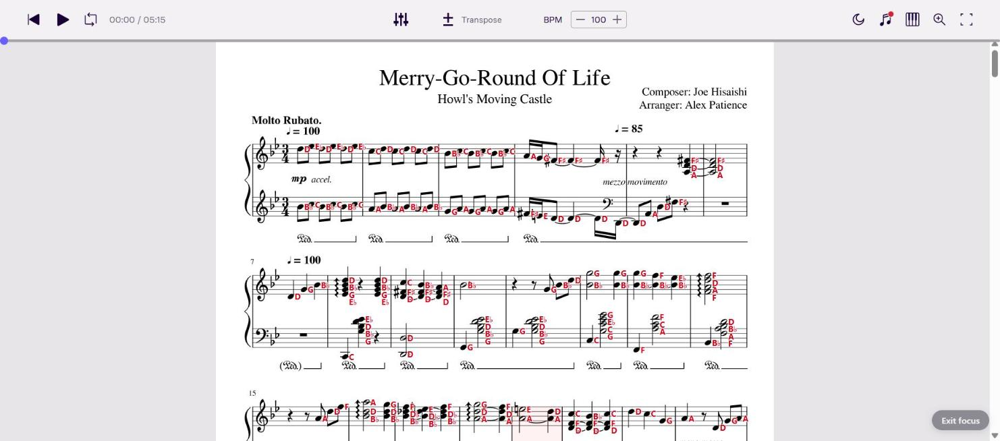

# Note Names for MuseScore

A Chrome extension that writes the name of every note on
[musescore.com](https://musescore.com) sheet music. It works like the
*Note Names* plugin in the MuseScore app. It also has a **focus mode** that
leaves only the score and the player.

**Website:** https://arihant25.github.io/musescore-note-names/



## Install

- **Chrome Web Store:** coming soon.
- **From a release:** download `note-names-for-musescore.zip` from the
  [latest release](https://github.com/Arihant25/musescore-note-names/releases/latest)
  and unzip it. Open `chrome://extensions` and turn on **Developer mode**.
  Click **Load unpacked** and pick the unzipped folder.
- **From source:** same as above, but pick this repository's folder.

## Using it

Click the toolbar icon to open the settings:

| Setting | Options |
| --- | --- |
| On/off switch | also <kbd>Alt</kbd>+<kbd>N</kbd> |
| Focus mode | hides the header, banners, sidebar, recommendations and comments, leaving only the pages and the player (play, mixer, transpose, tempo, piano roll…). Also <kbd>Alt</kbd>+<kbd>Shift</kbd>+<kbd>F</kbd>; <kbd>Esc</kbd> or the *Exit focus* pill leaves it. It stays on as you move between scores. |
| Naming | C D E · German (H, Fis, Es) · Do Re Mi … Si · Do Re Mi … Ti |
| Position | next to each note (default) · above the staff · below the staff |
| Size, colour | labels never shrink below about 12 px on screen, whatever the zoom level |
| Extras | a colour per note letter, octave numbers (C4 = middle C), ASCII `#`/`b` |

You can change the shortcuts at `chrome://extensions/shortcuts`.

## How it works

musescore.com shows each page as an SVG exported by MuseScore. The SVG has
no pitch data, but every element carries a class name (`Note`, `StaffLines`,
`Clef`, `KeySig`, `Accidental`, `BarLine`, `LedgerLine`, …).
`src/analyzer.js` reads the music back from the geometry:

1. It parses every path (including packed arc flags) into subpaths and
   bounding boxes, then clusters those into glyphs. Holes and relative
   sub-paths join their outline.
2. It rebuilds 5-line staves from the staff lines.
3. It classifies clefs (treble/bass/C clefs, octave clefs, percussion) by
   their size and position on the staff. Mid-system clef changes work too.
4. It classifies accidentals by where their outline sits inside the bounding
   box. Compound glyphs (𝄫, ♮♯, ♮♭) are split and read half by half. Key
   signatures are read the same way, so key changes work.
5. It assigns each notehead to a staff. Notes far outside a staff count only
   if that staff's ledger lines run under them, which handles notes written
   between the two staves of a grand staff.
6. It works out pitch from the line/space position and the clef. Then it
   applies the key signature, accidentals carried to the end of the bar, and
   accidentals carried over a barline by a tie.

`src/content.js` finds the page images as they lazy-load, fetches each SVG
(cross-origin pages go through the service worker), and draws an SVG overlay
above the image. `src/focus.js` implements focus mode. It finds the layout by
structure rather than by the site's hashed class names.

### Tested on

Für Elise, Chopin Nocturne Op. 9 No. 2, Fantaisie-Impromptu (double sharps,
♮♯, key change to D♭), La Campanella, Clair de Lune, Gymnopédie No. 1,
Merry-Go-Round of Life, and a viola (alto clef) score. On every page of these
scores, all noteheads were placed and all accidentals were attached.

## Limitations

* Some (mostly older) scores are only available as PNG images. These can't
  be read, and the popup says so.
* Names show the **written** pitch. 8va/8vb lines are ignored, so octave
  numbers inside them are off by one octave, and transposing instruments
  show written rather than concert pitch. The site's *Transpose* control
  works, because it loads new images.
* A tie that crosses a system break doesn't carry its accidental to the next
  system.
* Unison notes from two voices that share a notehead get one label.

## Releasing

```sh
python dev/package.py   # writes dist/note-names-for-musescore-<version>.zip
```

The zip contains only what the extension needs. Upload it to a GitHub
release and to the Chrome Web Store. Store screenshots and the promo tile
are in `store/`. The listing text is in `store/listing.md`.

## Development

```sh
python dev/serve.py   # serves this folder on http://127.0.0.1:8765
```

Then run this in the DevTools console of a musescore.com score page:

```js
(0,eval)(await (await fetch('http://127.0.0.1:8765/dev/harness.js')).text())
await MSNNDev.reload()          // load src/*.js from disk
await MSNNDev.collect()         // fetch every page's SVG
MSNNDev.problems()              // unplaced noteheads / unattached accidentals
MSNNDev.report()                // clefs and key signatures per staff
MSNNDev.crop(0, x, y, w, h)     // enlarged page region with labels
```

## License

MIT. Not affiliated with MuseScore or Muse Group.
